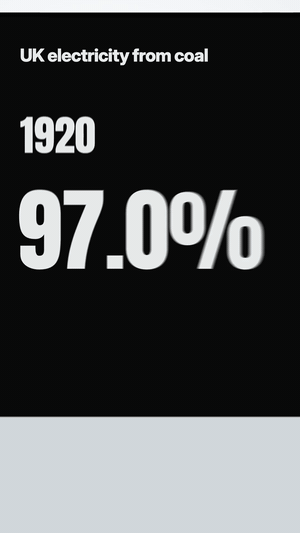

# Motion Skills: Claude Motion-style videos in Claude Code, Codex or Cursor

**Motion Director is a free Claude Code skill for making short animated videos, and a free alternative to Claude Motion for people on Pro or Max.** Claude Motion is in beta on Claude Team and Enterprise only. With this skill, your coding agent takes your own material (a site, a repo, a changelog, a spreadsheet, notes) and directs a short animated film with music: a launch teaser, a product demo, an explainer, a data video or a vertical short. It renders the MP4 on your computer.

- **No Remotion setup.** The agent writes the film as one HTML page (HTML, CSS and GSAP), and the engine renders it in the Chrome you already have.
- **Any Claude plan.** It works on Pro and Max and in other agents; you don't need Claude Motion, which is in beta on Team and Enterprise.
- **No video model, no credits, no upload.** Everything runs and renders locally.
- **Checked before you see it.** Before rendering, the engine looks for cut-off, covered and low-contrast text, blank stretches and single-frame pops.

<p align="center">
  
  <br><sub>Made by Motion Director from the sample <code>examples/CHANGELOG.md</code> (a made-up app). The real film has its own score.</sub>
</p>

**In this README:** [Quick start](#quick-start) · [Three runs, start to finish](#three-runs-start-to-finish) · [What it makes](#what-motion-director-makes) · [How it compares](#how-it-compares) · [Security and privacy](#security-and-privacy)

## Quick start

**1. Check your machine.** You need Node.js 22+, FFmpeg and Chrome:

```sh
npx motion-skills doctor
```

**2. Install the skill.** Copy `skills/motion-director` into your agent's skills folder:

| Agent | Folder |
|---|---|
| Claude Code | `~/.claude/skills/motion-director/` (or `.claude/skills/` inside a project) |
| Codex | `~/.agents/skills/motion-director/` |
| Cursor | `.cursor/skills/motion-director/` inside the project |
| Gemini CLI | `~/.gemini/skills/motion-director/` |

```sh
git clone https://github.com/hideewsj-maker/motion-skills.git
mkdir -p ~/.claude/skills && cp -R motion-skills/skills/motion-director ~/.claude/skills/
```

Or ask your agent to do it: *"Install the motion-director skill from https://github.com/hideewsj-maker/motion-skills into your skills folder."*

**3. Ask for a film:**

> Use the motion-director skill: a 15-second launch teaser for our 2.0 release, 16:9, from the notes in CHANGELOG.md.

The agent proposes **three directions**, each a one-line pitch with one still. You pick one, and it builds the film, writes its music, checks every frame and renders `out/film.mp4`. To change it, say so in plain words: *"make the second scene shorter"*, *"use our brand colours"*. You can also open `npx motion-skills studio`, click a spot in the frame and type the change there.

## Three runs, start to finish

What went in, what was asked, what came out and how long it took. Each is one whole run on November 12, 2026, with Claude Opus 5.5 as the coding agent and nobody at the keyboard: the agent drew its three directions, picked one itself and rendered. Nobody asked for a change afterwards. The films are shown as they were rendered (the real ones have music).

| | Given | Asked | Took | Got |
|---|---|---|---|---|
| **1** | [`CHANGELOG.md`](skills/motion-director/examples/CHANGELOG.md) of a made-up invoicing app | *"Use the motion-director skill: a 15-second launch teaser for our 2.0 release, 16:9, from the notes in CHANGELOG.md."* | **16 min** | 15 s · 16:9 launch teaser |
| **2** | `uk-coal-share.csv`, 106 rows ([Our World in Data](https://ourworldindata.org/grapher/share-electricity-coal), citing Ember, CC BY 4.0) | *"Use the motion-director skill: a vertical 9:16 film, about 15 seconds, of the UK coming off coal, from uk-coal-share.csv (source in SOURCE.md). Music, no voiceover. Show the source on screen."* | **14 min** | 15 s · 9:16 data video |
| **3** | `notes.md`, six bullet points on the rule of 72 | *"Use the motion-director skill: explain the rule of 72 in about 20 seconds, 16:9, from my notes in notes.md. For people new to saving."* | **12 min** | 20 s · 16:9 explainer |

<p align="center">
  <a href="https://claude-motion.com/skills/motion-director#cases"></a>
  <br><sub><b>1.</b> The link is copied, the client pays by card, the invoice is stamped Paid, then the number from the beta. The invoice is a made-up sample and says so on screen.</sub>
</p>

<p align="center">
  <a href="https://claude-motion.com/skills/motion-director#cases"></a>
  <br><sub><b>2.</b> The screen is the chart: black is coal's share, and the counter steps through all 106 rows. The agent saw smeared digits in its first render, fixed them and rendered again; that is inside the 14 minutes.</sub>
</p>

<p align="center">
  <a href="https://claude-motion.com/skills/motion-director#cases"></a>
  <br><sub><b>3.</b> Two timelines on one scale: at 9% the coin doubles at year 8, at 3% at year 24. Every number is in the notes.</sub>
</p>

Time is wall-clock, from the agent's first command to the rendered MP4, with all three running at once on one Apple-silicon Mac, on our development copy of the engine (0.1.6). Your agent, model and machine will change it. The films with sound are at [claude-motion.com/skills/motion-director](https://claude-motion.com/skills/motion-director#cases).

## What Motion Director makes

One 10–20 second film of whatever you bring:

| You bring | You get |
|---|---|
| A product, a site, a release | A teaser: the name, the one thing it does, shown in use, and the line |
| A number or a dataset | One data point that lands, drawn to scale, with its source |
| An idea, notes, an article | One idea explained, with the thing itself moving |
| A script or a hook | A vertical 9:16 hook for TikTok, Reels or Shorts |

## Full films

Motion Director is deliberately short. Each kind of film has its own full-film skill. It picks up the same project and makes the whole film at the length that type needs (from a few-second logo sting to a two-minute lesson), with that type's structure and styles built in. These skills are paid: **$4.90 each, once**, or all of them for $9.90 a month. Browse them at **[claude-motion.com/skills](https://claude-motion.com/skills)**.

| Scene | Full-film skills |
|---|---|
| Launch | [Launch Video](https://claude-motion.com/directors/launch-director) · [Walkthrough](https://claude-motion.com/directors/walkthrough-director) · [Comparison](https://claude-motion.com/directors/comparison-director) · [Brand Intro](https://claude-motion.com/directors/brand-director) · [Event Promo](https://claude-motion.com/directors/event-director) · [App Store Preview](https://claude-motion.com/directors/app-preview-director) |
| Social | [Vertical Short](https://claude-motion.com/directors/shorts-director) · [Talking-head Video](https://claude-motion.com/directors/talking-head-director) · [Titles & Transitions](https://claude-motion.com/directors/titles-director) · [Social Card](https://claude-motion.com/directors/card-director) |
| Reports | [Data Video](https://claude-motion.com/directors/data-director) · [Team Update](https://claude-motion.com/directors/update-director) · [Narrated Deck](https://claude-motion.com/directors/deck-director) · [Investor Update](https://claude-motion.com/directors/investor-director) · [Session Replay](https://claude-motion.com/directors/replay-director) |
| Teach | [Explainer](https://claude-motion.com/directors/explainer-director) · [Lesson](https://claude-motion.com/directors/lesson-director) · [Research Paper](https://claude-motion.com/directors/paper-director) · [Timeline](https://claude-motion.com/directors/timeline-director) · [Math Explainer](https://claude-motion.com/directors/math-director) |
| Personal | [Year in Review](https://claude-motion.com/directors/year-director) · [Travel Map](https://claude-motion.com/directors/trip-director) · [Video Invitation](https://claude-motion.com/directors/invitation-director) |
| Commerce | [Product Video](https://claude-motion.com/directors/product-director) · [Drop & Sale Promo](https://claude-motion.com/directors/drop-director) |
| Evidence | [News Short](https://claude-motion.com/directors/news-director) · [Investigation Film](https://claude-motion.com/directors/investigation-director) |

## How it compares

| | Claude Motion | Remotion + Claude Code | Motion Skills |
|---|---|---|---|
| Where it runs | Inside a Claude chat | Your coding agent, in a React project you set up | Your coding agent, any plan |
| Who can use it | Team and Enterprise (beta) | Anyone; companies of more than three people need a Remotion license | Anyone; this skill is free, full-film skills are paid |
| What you start from | A prompt | A Remotion project | A skill that directs one kind of film |
| Output | MP4 | MP4 and more | MP4, MOV with alpha, WebM, GIF, CapCut / 剪映 draft |

## The engine

The skill builds with the [`motion-skills`](https://www.npmjs.com/package/motion-skills) engine on npm. It provides `mo new`, `mo studio`, `mo check`, `mo sound`, `mo render` and the rest. You don't install it yourself: the skill runs it through `npx motion-skills`.

## More

- **[HTML to video](https://claude-motion.com/html-to-video):** already have an HTML animation, for example one from a Claude or ChatGPT artifact? Record it as an MP4 in your browser. Free, no upload.
- **[Claude Motion prompts](https://claude-motion.com/claude-motion-prompts):** ready-to-paste motion prompts, with previews.

## Security and privacy

- **Nothing is uploaded.** The agent writes the film as files in your project folder, and the engine renders them in the Chrome already on your machine. There is no cloud render, no video model and no API key.
- **What you install is readable.** The skill is the Markdown in [`skills/motion-director`](skills/motion-director): a `SKILL.md` and its references, no binaries and no install scripts. The engine is the [`motion-skills`](https://www.npmjs.com/package/motion-skills) package on npm, MIT licensed, plain JavaScript you can read in `node_modules`.
- **No account for this route.** Copying the skill folder from this repository needs no sign-in.
- **Telemetry, and how to turn it off.** When a render finishes, the engine sends claude-motion.com five things: the skill's name, the step, whether it worked (on failure one word such as `ffmpeg` or `disk`), the engine's version, and a random number made for that project so a retried film is not counted twice. It never sends a file, a path, your text or any of the film. Set `MOTION_SKILLS_TELEMETRY=0` to send nothing.
- **Network use.** `npx` downloads the engine from npm the first time, and `mo fonts add` downloads the fonts a film uses into the project folder. Your material is read where it is.
- **Found a problem?** Open an issue here or write to hi@claude-motion.com.

## License

- The Motion Director skill (`skills/motion-director/`) is free to use and modify, and everything you render with it is yours, including for commercial and client work. See [its license](skills/motion-director/LICENSE.md). Fork it for your own use; please don't repackage it into another skill library or marketplace.

Motion Skills is an independent project and is not affiliated with Anthropic. Claude is a trademark of Anthropic, PBC.
